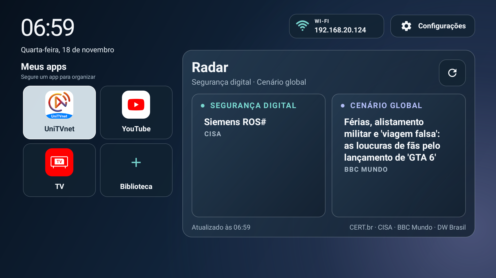

<div align="center">
  
  <h1>Atlas TV</h1>
  <p>Uma tela inicial nativa, leve e feita para Android TV.</p>
  <p>
    <a href="https://github.com/gustavx404/atlas-launcher/actions/workflows/android.yml"></a>
    
    
    
  </p>
</div>

## O projeto

O Atlas é um launcher Android TV escrito em Java com componentes nativos do Android. Ele reúne apps, entradas de vídeo, rede, relógio e notícias em uma interface própria, com navegação pensada para controle remoto e aparelhos com recursos limitados.

<p align="center">
  
</p>

## O que oferece

- **Tela inicial:** relógio, data, estado da rede, atalhos reorganizáveis e painel Radar.
- **Biblioteca:** apps instalados e entradas AV/HDMI, acessíveis pelo D-pad.
- **Personalização:** papel de parede, widgets e fontes de notícias configuráveis.
- **Interface Atlas:** ícones enquadrados em uma linguagem visual comum, vetores próprios e foco visível.
- **Leveza:** views nativas, fundo desenhado por shader e cache de ícones limitado.

## Compilar

Requisitos: JDK 17 e Android SDK com a plataforma 36.

```sh
cd apps/atlas-native
./gradlew assembleRelease
```

O APK local é gerado em `app/build/outputs/apk/release/app-release-unsigned.apk`.

## CI e releases

O [workflow Android APK](https://github.com/gustavx404/atlas-launcher/actions/workflows/android.yml) compila em pushes para `main`, pull requests e execuções manuais. O artefato de CI contém o APK sem assinatura e o checksum SHA-256.

Para uma release instalável, envie uma tag `v*`:

```sh
git tag v0.2.1
git push origin v0.2.1
```

O workflow assina o APK e cria uma [GitHub Release](https://github.com/gustavx404/atlas-launcher/releases) com o pacote e seu checksum. Uma execução manual com `sign_apk=true` gera um APK assinado sem publicar uma release.

A assinatura usa Secrets do GitHub Actions. A chave privada não fica neste repositório; é necessário preservar a mesma chave para atualizar uma instalação existente. O certificado configurado é o da TV de desenvolvimento e não é uma chave de publicação da Play Store.

## Organização

```text
apps/atlas-native/   Aplicativo Android e instruções técnicas
docs/                Documentação do aparelho e decisões do launcher
.github/workflows/   Compilação e publicação de APKs
```

Consulte [apps/atlas-native/README.md](apps/atlas-native/README.md) para detalhes da interface, implementação e desempenho.
