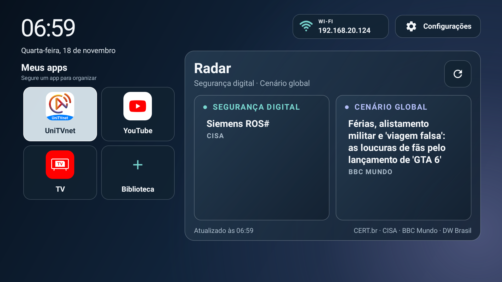

# Atlas TV · aplicativo Android

Launcher para Android TV 11 ou superior, escrito em Java e baseado em views nativas. Não usa AndroidX nem runtime externo de interface.

## Tela inicial

<p align="center">
  
</p>

O Atlas reúne apps fixados, informações de rede e manchetes em uma única tela, navegável pelo controle remoto.

## Interface

- Relógio, data, Wi-Fi/Ethernet e endereço IPv4 local.
- Apps fixados com reorganização pelo controle remoto.
- Biblioteca com atividades instaladas e entradas passthrough, como AV e HDMI.
- Painel Radar para segurança digital e cenário global, com fontes configuráveis.
- Configurações próprias para papel de parede e widgets.
- Foco visível e navegação D-pad em todas as áreas principais.
- Cartões translúcidos com acabamento fosco leve e leitura de notícias dentro do Atlas, sem abrir navegador.

## Implementação e desempenho

- O fundo é desenhado com shaders estáticos, sem decodificar uma imagem em tela cheia.
- Os painéis usam gradientes translúcidos sobre o fundo existente; evitam capturar e desfocar a tela em bitmap.
- Tela inicial e biblioteca usam caixas de ícone idênticas, sem aro externo, com escala, máscara e respiro uniformes; os símbolos originais continuam reconhecíveis.
- O Radar abre um leitor nativo com o resumo do feed e pode buscar o texto da fonte em segundo plano. O conteúdo é exibido no próprio Atlas, sem WebView ou navegador externo.
- O cache LRU compartilhado dos bitmaps tem limite de 2 MiB e é esvaziado sob pressão de memória.
- O APK de release é minificado e direcionado à ABI `armeabi-v7a`.

## Desenvolvimento

Requisitos: JDK 17 e Android SDK 36.

```sh
./gradlew assembleRelease
```

O APK local sem assinatura fica em `app/build/outputs/apk/release/app-release-unsigned.apk`. O workflow [Android APK](../../.github/workflows/android.yml) executa essa compilação em pushes e pull requests. Tags `v*` geram um APK assinado e uma GitHub Release; a execução manual também pode gerar um APK assinado com `sign_apk=true`.

A assinatura está nos Secrets do repositório. Para instalar atualizações sobre a TV de desenvolvimento, mantenha a mesma chave privada; ela não é armazenada no Git.

## Documentação relacionada

- [Visão geral do Atlas](../../docs/launcher-widgets.md)
- [Ficha do aparelho](../../docs/aparelho.md)
- [Plano de debloat](../../docs/debloat.md)
